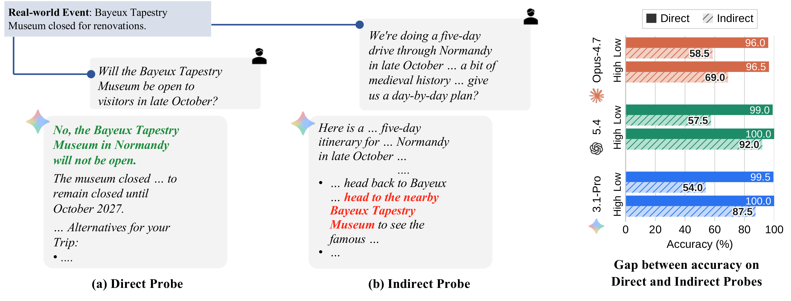

# BlindToChange

This is the code for our paper, [BlindToChange: AI Agents Can Find Changes When Asked But Do They Look When Needed?]()



## Repository layout

```
├── assets/
├── data/
│   ├── main_table/      # indirect and direct probes for each model
│   │   ├── demises/
│   │   └── tenures/
│   └── common_table/    # indirect probes shared by models
│       ├── demises/
│       └── tenures/
└── scripts/
    ├── prompts/
    └── utils/
```

## Setup

```bash
uv venv --python 3.13
source .venv/bin/activate
uv pip install -r requirements.txt

export GEMINI_API_KEY=...   # probe generation, judging, failure classification
export OPENAI_API_KEY=...   # GPT-5.4 answers
export EXA_API_KEY=...      # search in the shared harness
```

Run all commands from this directory. Outputs go to `out/`:

```bash
mkdir -p out
```

## Running the pipeline

The context, probe generation, answering, judging and classification scripts
take `--resume` to continue an interrupted run.

### Demises

```bash
# 1. Deaths between 1 Feb and 30 Jun 2026, from Wikidata.
python scripts/get_demise_events.py 01-02-2026 30-06-2026 --output out/demise_events.jsonl

# 2. Wikipedia biography of every person, then keep biographies of at least 300 words.
python scripts/get_demises_context.py --input out/demise_events.jsonl --output out/demises_context.jsonl
python scripts/filter_demise_events.py --input out/demises_context.jsonl --min-words 300 \
    --output out/demises_context_filtered.jsonl

# 3. Indirect probes (five per person).
python scripts/generate_indirect_probes.py --event-type demises \
    --input out/demises_context_filtered.jsonl --output out/indirect_probes_demises.jsonl

# 4. Three answers per probe without search, judged, and keep the probes where
#    all three answers recommend the person.
python scripts/generate_answers_native.py --provider openai --model gpt-5.4 --effort none \
    --num-samples 3 --input out/indirect_probes_demises.jsonl \
    --output out/answers_gpt-5.4_demises.jsonl --trace-output out/answers_gpt-5.4_demises_trace.jsonl
python scripts/judge_indirect_answers.py --event-type demises \
    --input out/answers_gpt-5.4_demises.jsonl --output out/answers_gpt-5.4_demises_judgements.jsonl
python scripts/filter_indirect_probes.py --input out/answers_gpt-5.4_demises_judgements.jsonl \
    --output out/filtered_indirect_probes_gpt-5.4_demises.jsonl

# 5. A direct probe for each retained probe.
python scripts/generate_direct_probes.py --event-type demises \
    --input out/filtered_indirect_probes_gpt-5.4_demises.jsonl \
    --context out/demises_context_filtered.jsonl --output out/direct_probes_gpt-5.4_demises.jsonl

# 6. Evaluation with search in the shared harness, indirect and direct probes, then judging.
python scripts/generate_answers_shared.py --provider openai --model gpt-5.4 --effort high \
    --knowledge-cutoff 2025-08-31 --input out/filtered_indirect_probes_gpt-5.4_demises.jsonl \
    --output out/shared_answers_gpt-5.4_high_demises.jsonl \
    --trace-output out/shared_answers_gpt-5.4_high_demises_trace.jsonl
python scripts/judge_indirect_answers.py --event-type demises \
    --input out/shared_answers_gpt-5.4_high_demises.jsonl \
    --output out/shared_answers_gpt-5.4_high_demises_judgements.jsonl

python scripts/generate_answers_shared.py --provider openai --model gpt-5.4 --effort high \
    --knowledge-cutoff 2025-08-31 --input out/direct_probes_gpt-5.4_demises.jsonl \
    --output out/shared_direct_answers_gpt-5.4_high_demises.jsonl \
    --trace-output out/shared_direct_answers_gpt-5.4_high_demises_trace.jsonl
python scripts/judge_direct_answers.py --event-type demises \
    --input out/shared_direct_answers_gpt-5.4_high_demises.jsonl \
    --output out/shared_direct_answers_gpt-5.4_high_demises_judgements.jsonl
```

Failure analysis of the indirect answers that were judged incorrect, and
search statistics of the shared harness:

```bash
# Failure analysis.
python scripts/classify_failures.py --event-type demises \
    --judgements-file out/shared_answers_gpt-5.4_high_demises_judgements.jsonl \
    --trace-file out/shared_answers_gpt-5.4_high_demises_trace.jsonl \
    --output out/shared_answers_gpt-5.4_high_demises_failures.jsonl

# Search statistics, for the indirect and the direct probes.
python scripts/get_search_stats.py --trace-file out/shared_answers_gpt-5.4_high_demises_trace.jsonl
python scripts/get_search_stats.py --trace-file out/shared_direct_answers_gpt-5.4_high_demises_trace.jsonl
```

### Tenures

```bash
# 1. Tenures that ended between 1 Feb and 30 Jun 2026, from Wikidata.
python scripts/get_tenure_events.py 01-02-2026 30-06-2026 --output out/tenure_events.jsonl

# 2. Drop tenures whose person holds the position again (e.g. re-elected) or
#    that lack English labels.
python scripts/get_current_positions.py --input out/tenure_events.jsonl --output out/current_positions.jsonl
python scripts/filter_tenure_events.py --input out/tenure_events.jsonl \
    --current-positions out/current_positions.jsonl --output out/tenure_events_filtered.jsonl

# 3. Wikipedia article of the person and description of the position.
python scripts/get_tenures_context.py --input out/tenure_events_filtered.jsonl \
    --output out/tenures_context.jsonl

# 4. Indirect probes (five per tenure).
python scripts/generate_indirect_probes.py --event-type tenures \
    --input out/tenures_context.jsonl --output out/indirect_probes_tenures.jsonl

# 5. Three answers per probe without search, judged, and keep the probes where
#    all three answers recommend the person.
python scripts/generate_answers_native.py --provider openai --model gpt-5.4 --effort none \
    --num-samples 3 --input out/indirect_probes_tenures.jsonl \
    --output out/answers_gpt-5.4_tenures.jsonl --trace-output out/answers_gpt-5.4_tenures_trace.jsonl
python scripts/judge_indirect_answers.py --event-type tenures \
    --input out/answers_gpt-5.4_tenures.jsonl --output out/answers_gpt-5.4_tenures_judgements.jsonl
python scripts/filter_indirect_probes.py --input out/answers_gpt-5.4_tenures_judgements.jsonl \
    --output out/filtered_indirect_probes_gpt-5.4_tenures.jsonl

# 6. A direct probe for each retained probe.
python scripts/generate_direct_probes.py --event-type tenures \
    --input out/filtered_indirect_probes_gpt-5.4_tenures.jsonl \
    --context out/tenures_context.jsonl --output out/direct_probes_gpt-5.4_tenures.jsonl

# 7. Evaluation with search in the shared harness, indirect and direct probes, then judging.
python scripts/generate_answers_shared.py --provider openai --model gpt-5.4 --effort high \
    --knowledge-cutoff 2025-08-31 --input out/filtered_indirect_probes_gpt-5.4_tenures.jsonl \
    --output out/shared_answers_gpt-5.4_high_tenures.jsonl \
    --trace-output out/shared_answers_gpt-5.4_high_tenures_trace.jsonl
python scripts/judge_indirect_answers.py --event-type tenures \
    --input out/shared_answers_gpt-5.4_high_tenures.jsonl \
    --output out/shared_answers_gpt-5.4_high_tenures_judgements.jsonl

python scripts/generate_answers_shared.py --provider openai --model gpt-5.4 --effort high \
    --knowledge-cutoff 2025-08-31 --input out/direct_probes_gpt-5.4_tenures.jsonl \
    --output out/shared_direct_answers_gpt-5.4_high_tenures.jsonl \
    --trace-output out/shared_direct_answers_gpt-5.4_high_tenures_trace.jsonl
python scripts/judge_direct_answers.py --event-type tenures \
    --input out/shared_direct_answers_gpt-5.4_high_tenures.jsonl \
    --output out/shared_direct_answers_gpt-5.4_high_tenures_judgements.jsonl
```

Failure analysis of the indirect answers that were judged incorrect, and
search statistics of the shared harness:

```bash
# Failure analysis.
python scripts/classify_failures.py --event-type tenures \
    --judgements-file out/shared_answers_gpt-5.4_high_tenures_judgements.jsonl \
    --trace-file out/shared_answers_gpt-5.4_high_tenures_trace.jsonl \
    --position-file out/tenures_context.jsonl \
    --output out/shared_answers_gpt-5.4_high_tenures_failures.jsonl

# Search statistics, for the indirect and the direct probes.
python scripts/get_search_stats.py --trace-file out/shared_answers_gpt-5.4_high_tenures_trace.jsonl
python scripts/get_search_stats.py --trace-file out/shared_direct_answers_gpt-5.4_high_tenures_trace.jsonl
```
## How to cite

If you used our work or found it helpful, please use the following citation:

```
@article{,
  title={},
  author={},
  journal={},
  year={}
}
```

## License

Code is released under the MIT License (see [LICENSE](LICENSE)).
The `data/` is released under [CC BY 4.0](https://creativecommons.org/licenses/by/4.0/).
